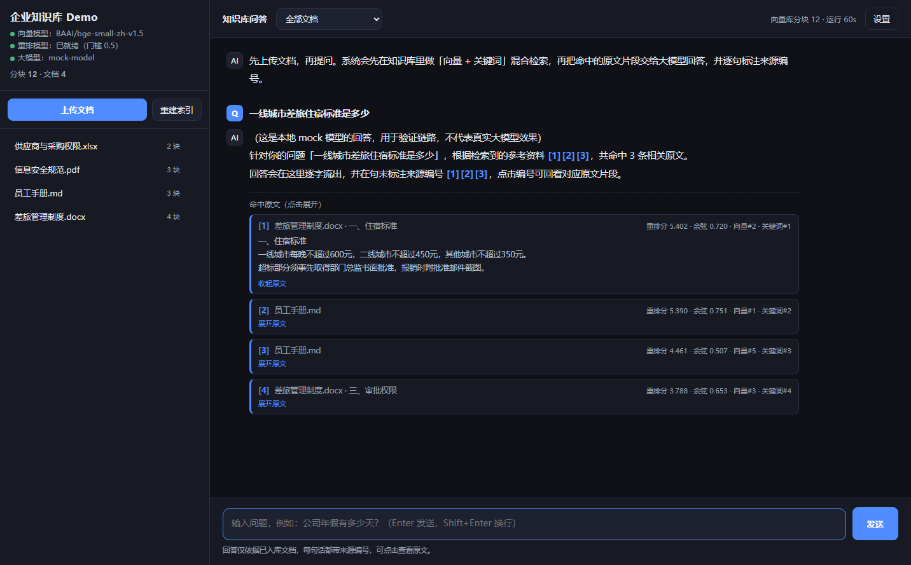

# 企业知识库 Demo（本地单机版）

一套**完全自建、可解释、可迁移**的 RAG 知识库。目标不是"装上就能用"，而是让你把
企业知识库的每个环节都亲手跑一遍，之后迁移到服务器/容器几乎不用改代码。

> 纯 Python 实现，**无需 Docker、无需 GPU、无需 PyTorch**。
> 在 7.6GB 内存的 Windows 笔记本上实测稳定运行，内存占用约 750MB。



*提问 → 混合检索 → Cross-Encoder 重排 → 带 `[编号]` 引用的回答；点击编号可回看原文，
每条引用都标出重排分、余弦相似度与两路召回排名。*

```
用户提问
   │
   ├─ 第一阶段 广召回 ────────────────────────────────┐
   │   ├─ 向量检索 FAISS（语义相近）                    │
   │   └─ BM25 关键词检索（专有名词、编号）             │
   │            ↓ RRF 融合（取前 20 条候选）            │
   │                                                   │
   ├─ 第二阶段 精排 ──────────────────────────────────┤
   │   └─ Cross-Encoder 重排（BAAI/bge-reranker-base） │
   │            ↓ 重排分门槛过滤                        │
   │                                                   │
   └─ 带编号的参考资料 → 大模型 → 带 [编号] 的回答 ◄────┘
                                    │
                                    └─ 点编号可回看原文
```

> **两段式检索是这套系统精度达标的关键**，不是可选项。
> 第一阶段保证"相关文档不漏"，第二阶段保证"无关内容不进上下文"。
> 第 4 节有实测数据说明为什么缺了第二阶段就一定会在某些问题上出错。

---

## 特性

- **中文优化**：BGE 中文向量模型 + BGE 中文重排模型，针对中文语义与专有名词调优
- **多格式解析**：PDF（含**页码溯源**）/ Word（含**章节溯源**）/ Excel（含**工作表溯源**）/ Markdown / TXT / CSV
- **两段式检索**：向量 + BM25 混合召回，Cross-Encoder 精排，阈值经实测标定
- **答案可溯源**：每个结论强制标注来源编号，点击可展开原文，幻觉无处藏身
- **短文档不丢**：切分阈值只过滤页眉页脚碎片，每份文档保证至少保留一块
- **零隐藏状态**：存储就是「一个索引文件 + 一个 JSON」，删掉即彻底重置
- **优雅降级**：重排模型不可用时自动退回余弦门槛，服务不中断
- **不需要大模型 Key 也能跑**：内置 mock 模型可先验证整条数据链路

---

## 一、目录结构

```
E:\deepseek\kb\
├── app\
│   ├── config.py        # 所有参数集中在此，改 .env 即可
│   ├── ingest.py        # 解析(PDF/Word/Excel/TXT/MD) + 中文感知切分
│   ├── embedding.py     # fastembed(ONNX) 加载 BGE 中文向量模型
│   ├── retrieval.py     # 混合召回 + RRF 融合 + 重排编排 + 相关性闸门
│   ├── rerank.py        # Cross-Encoder 重排（可降级）
│   ├── kb.py            # FAISS 索引 + JSON 元数据的读写与统计
│   ├── rag.py           # 拼参考资料 + 调大模型 + 流式输出
│   ├── main.py          # FastAPI 接口
│   └── static\index.html# 网页界面（原生 JS，无构建）
├── data\
│   ├── source\          # 原始文档放这里
│   └── index\           # kb.index（向量索引）+ kb.json（分块与元数据）
├── models\              # 模型缓存（内网离线部署时整体拷贝此目录）
├── logs\
├── tools\               # 辅助脚本
│   ├── make_samples.py  # 生成 Word/Excel/PDF 测试文档
│   ├── make_pdf.py      # 生成带页码的中文 PDF（验证页码溯源）
│   ├── mock_llm.py      # 本地 mock 大模型（无 Key 时验证全链路）
│   └── ui_shot.py       # 驱动无头 Chrome 真实提问并截图
├── verify.py            # 端到端自检脚本
├── requirements.txt
└── .env                 # 密钥与参数（不提交到 git）
```

**内存占用实测**（本机 7.6GB 内存，运行稳定）：
向量模型约 200MB + 重排模型约 400MB + 服务本体约 150MB ≈ **750MB**。
若换 `BAAI/bge-reranker-v2-m3`（2.27GB）请先确认内存余量。

**重置索引**＝删掉 `data\index` 目录（或调用 `POST /api/reset`），没有任何隐藏状态。

---

## 二、启动

```powershell
cd E:\deepseek\kb

# 方式一：双击 启动知识库.bat
# 方式二：命令行
.\.venv\Scripts\python.exe -m uvicorn app.main:app --host 127.0.0.1 --port 8000

# 浏览器打开
start http://127.0.0.1:8000
```

界面左侧上传文档（PDF / Word / Excel / TXT / Markdown），右侧提问。

端到端自检：

```powershell
.\.venv\Scripts\python.exe verify.py          # 在现有数据上巡检（默认安全）
```

**没有大模型 Key 也能先跑通全链路**：用仓库里的 mock 服务替代真实模型，
验证「检索 → 重排 → 组 prompt → 流式输出 → 引用渲染」这条通路：

```powershell
# 终端 A：启动 mock 大模型（仅测试用）
.\.venv\Scripts\python.exe -m uvicorn tools.mock_llm:app --port 8001

# 终端 B：让知识库指向 mock
$env:LLM_BASE_URL='http://127.0.0.1:8001/v1'; $env:LLM_API_KEY='mock'; $env:LLM_MODEL='mock-model'
.\.venv\Scripts\python.exe -m uvicorn app.main:app --port 8000
```

---

## 三、配置大模型

编辑 `.env`（或页面右上角「设置」）：

```ini
LLM_API_KEY=sk-你的key
LLM_BASE_URL=https://api.deepseek.com/v1
LLM_MODEL=deepseek-chat
```

任何 **OpenAI 兼容**接口都能用（通义千问、智谱、vLLM、企业内网模型网关），
改 `LLM_BASE_URL` 与 `LLM_MODEL` 即可。**不配 Key 也能用**——此时只做检索，
页面会提示未配置，方便先验证数据链路。

---

## 四、关键设计说明（企业落地时最值得关注的四点）

### 1. 两段式检索：这是精度达标的关键

**只有"向量 + 关键词"是不够的。** 这套系统在开发过程中用 10 个真相关问题 +
8 个无关问题做过实测标定，数据如下（4 份示例文档，中文 BGE 模型）：

| 问题 | 类型 | 余弦相似度 | 重排分 |
|---|---|---|---|
| 出差住酒店能报多少钱 | 相关 | 0.7130 | **2.63** |
| ISO27001是什么认证 | 相关 | 0.4537 | **1.85** |
| **北京到上海高铁多久** | **无关** | **0.6370** | **-0.043** |
| Python怎么读文件 | 无关 | 0.4154 | **-7.27** |

看第三行——**无关问题的余弦相似度（0.637）比真相关问题（0.454）还高**。
原因是文档里有「高铁乘坐二等座」，BM25 把"高铁"当稀有词给了极高分数，
硬把它顶了上来。这是**关键词路污染语义路**的典型表现，也是纯阈值方案的根本缺陷：

> 余弦阈值扫描结果：相关区间 0.45~0.78，无关区间 0.30~0.64，**两段重叠**。
> 无论阈值取 0.45 还是 0.64，都必然在"漏拦假阳性"和"误杀真相关"之间二选一。

加上 Cross-Encoder 重排后，**两段区间完全不重叠**：

| | 相关（10 个问题 × 全部候选） | 无关（4 个问题 × 全部候选） |
|---|---|---|
| 重排分 | 0.43 ~ 4.91 | -10.19 ~ **-0.043** |

阈值扫描确认安全区为 **0.0 ~ 0.5**，默认取上边界 **0.5**（在零误杀的前提下精度最高）：

| 阈值 | 相关问题零引用（误杀） | 无关问题漏拦 |
|---|---|---|
| 0.0 | 0 | 0 |
| **0.5（默认）** | **0** | **0** |
| 1.0 | 1 ← 误杀 | 0 |

所以架构是：**第一阶段广召回（保住召回率）→ 第二阶段重排（保住精度）**。
这也是生产级 RAG 的标准做法——如果你的知识库方案里没有重排环节，
它在"用户问了个不相关的问题"时几乎一定会给出编造的答案。

> 代价：重排模型 `BAAI/bge-reranker-base` 约 1.04GB，首次启用需下载，
> CPU 上每次查询增加约 0.1~0.5 秒。企业里若追求更强效果可换
> `BAAI/bge-reranker-v2-m3`；若算力紧张可用 `Xenova/ms-marco-MiniLM-L-6-v2`（80MB）。
> 通过 `KB_RERANK=0` 可关闭并按降级模式运行（此时上面那个漏拦问题会复现）。

### 2. 为什么是"向量 + 关键词"两路检索

纯向量检索在企业文档上有两个稳定出现的短板：

| 场景 | 纯向量 | 加 BM25 |
|---|---|---|
| 问「HT-2024-087 谁审批」 | 编号被当成噪声，经常漏 | 编号精确命中 |
| 问「ISO27001」 | 可能召回一堆泛泛的信息安全内容 | 精确命中该词所在段落 |
| 问「年假怎么算」 | 召回好 | 帮忙补齐 |

两路召回后用 **RRF（倒数排名融合）** 合并：只看排名不看分数，
不依赖两路分数量纲可比，比"加权求和"稳得多。
注意 RRF 融合分**只用于排序**，不能当"相关度"展示——它的量级约 0.016，
跨查询也不可比较。对外展示的相关度用的是余弦相似度与重排分。

### 3. 为什么答案必须带 `[编号]`

企业知识库最大的风险不是"答不出"，而是**"答错了还看不出来"**。
所以这里做了三层约束：

- 系统提示词里硬性要求：每个结论必须标注来源编号，资料不足必须说"无法回答"；
- 每个分块都带 `source / page / section` 元数据，PDF 精确到**页码**，Word 精确到**章节**；
- 前端把 `[1]` 渲染成可点击标记，点一下直接展开原文片段。

于是任何人都能复核答案，幻觉无处藏身。

### 3. 为什么不用 PyTorch / ChromaDB / LangChain

这三件事我都实际装过、试过，结论记录在此——**你在企业里选型时会遇到同样的坑**：

**① 不用 `sentence-transformers`**：它会拉入 PyTorch（约 2GB 磁盘、运行时数 GB 内存）。
本机 7.6G 内存、C 盘只剩 14G，跑起来非常勉强。
改用 **fastembed**（ONNX Runtime）加载 `BAAI/bge-small-zh-v1.5`：
磁盘约 90MB、内存约 200MB，中文效果不变（见 `verify.py` 的语义一致性检查）。

**② 不用 ChromaDB**：两个硬问题都实测到了——
- ChromaDB 1.5.9 的 Rust 内核在 Windows 上建库直接报
  `unable to open database file`，数据库文件明明已经创建却打不开；
- 降级到 0.5.x 需要现场编译 `chroma-hnswlib`，本机没有 C++ 编译器，装不上；
- 更关键的是，它内置的 ONNX 嵌入函数**硬编码英文模型** `all-MiniLM-L6-v2`
  （下载路径写死、不读环境变量），中文检索效果差。

改用 **FAISS**：官方提供 Windows 预编译 wheel，`IndexFlatIP` + 向量归一化即余弦相似度，
存储是「一个索引文件 + 一个 JSON」，删掉就重置，**完全显式、便于审计**。

**③ 不用 LangChain**：解析 → 切分 → 检索 → 生成每一步都在 `app\` 里显式可见。
企业知识库最终一定要按自己的文档特点调切分与检索，被框架抽象掉反而更难改。

### 5. 中文切分的三个细节

- **按段落→句子切，而不是固定字数切**：固定字数会把一句话拦腰截断；
- **块间重叠**：相邻块重叠 80 字符，避免答案恰好落在切口上；
- **表格单独成块**：Excel/Word 表格里的数字脱离表头就没有意义，所以整表保留；
- **短文档不丢**：切分阈值只用于过滤页眉页脚碎片，每份文档保证至少保留一块
  （开发中实测到一份 36 字符的摘要在纯阈值逻辑下被静默丢弃，已修）。

---

## 五、后期迁移到企业环境要改什么

| 项目 | 现在（单机 Demo） | 企业环境 |
|---|---|---|
| 向量检索 | FAISS 本地文件（单机） | Milvus / Qdrant / Elasticsearch 向量检索 |
| 部署 | 单进程 uvicorn | Docker + 反向代理 + systemd/K8s |
| 模型 | 本地 ONNX 小模型 | 内网模型服务或 GPU 推理集群 |
| 鉴权 | 无 | SSO / LDAP，按部门做文档权限过滤 |
| 文档来源 | 手工上传 | 对接 Confluence / 共享盘 / OA，定时增量同步 |

**代码层面需要改的很少**：`kb.py` 换存储实现（接口只有
`search / all_records / add_records / delete_source / reset_all` 五个函数）、
`retrieval.py` 换检索后端、`main.py` 加鉴权中间件。
其余（解析、切分、融合、提示词）可直接复用。

> 注意：FAISS 是**单机**索引，多人并发写入需要自行加锁；
> 上企业环境建议直接换成 Milvus/Qdrant，这两个问题都由服务端解决。

---

## 六、常见问题

**Q：首次启动很慢？**
首次会下载约 90MB 向量模型到 `models\fastembed`。之后启动只需几秒。
完全离线环境可把整个 `models\` 目录拷到目标机器。

**Q：扫描版 PDF 没有文本？**
本 Demo 不做 OCR，这类文件入库时会提示"未解析出文本"。
企业环境需另行接入 OCR（PaddleOCR 等）——这也是实际项目里绕不开的一步。

**Q：想换向量模型？**
改 `.env` 的 `KB_EMBED_MODEL`（可用 `fastembed` 支持的中文模型，
如 `BAAI/bge-small-zh-v1.5`、`jinaai/jina-embeddings-v2-base-zh`）。
换模型后**必须重建索引**，因为旧向量与新的不在同一语义空间：
删掉 `data\index` 目录，再点「重建索引」。

**Q：回答不准怎么调？**
按这个顺序排查：① 检索结果对不对（看答案里的来源片段与重排分）→ ② 切分是否把关键信息切碎
（调 `KB_CHUNK_SIZE`）→ ③ 参考资料条数够不够（调 `KB_FINAL_TOPK`、`KB_RERANK_CANDIDATES`）→
④ 最后才调提示词。**绝大多数"答不准"是检索没召回，不是模型不行。**

**Q：明明知识库里有，却回答"没有找到相关内容"？**
那是相关性闸门把结果拦掉了，属于**故意设计**（宁可拒答也不编造）。
处理顺序：① 先在页面看检索是否召回了正确片段（把 `KB_RERANK` 设 0 可看未过滤的原始结果）→
② 若正确片段重排分偏低，说明问法与文档措辞差异大，可下调 `KB_RERANK_MIN_SCORE`
（安全区 0.0~0.5）→ ③ 若确实没有相关内容，那就是该拒答。

**Q：门槛该怎么定？**
**不要凭感觉拍。** 准备约 10 个真相关问题 + 8 个无关问题，用
`retrieve()` 打印两组的分数分布，找两组不重叠的区间。本仓库的做法与实测数据见第四节第 1 点。
`verify.py` 里的 `硬负例` 检查就是这个方法的固化。

**Q：PowerShell 里中文显示成乱码？**
脚本执行前设置 `$env:PYTHONUTF8='1'` 和 `$env:PYTHONIOENCODING='utf-8'`，
或用 `启动知识库.bat`（内含 `chcp 65001`）。
注意：PowerShell 5.1 用 `Invoke-RestMethod` 打印中文会乱码，那是**控制台编码问题，
不是接口问题**——用 Python 或浏览器验证即可。

---

## 七、开发过程中的实测记录（含走过的弯路）

本项目的技术选型不是照搬教程，每一步都实测验证，过程记录如下——
**你在企业里选型时会踩到同样的坑**：

| # | 假设 | 实测结果 | 最终决定 |
|---|---|---|---|
| 1 | 用 ChromaDB 做向量库 | 1.5.9 的 Rust 内核在 Windows 上建库即报 `unable to open database file`（文件已创建却打不开）；降级 0.5.x 需现场编译 `chroma-hnswlib`，本机无 C++ 编译器 | 换 **FAISS** |
| 2 | 用 ChromaDB 内置 ONNX 嵌入 | 其默认函数**硬编码英文模型** `all-MiniLM-L6-v2`，下载路径写死且不读环境变量 → 中文检索效果差 | 换 **fastembed** |
| 3 | 用 sentence-transformers | 会拉入 PyTorch（约 2GB 磁盘、数 GB 内存），本机 7.6G 内存吃紧 | 全程 **ONNX**（约 750MB） |
| 4 | 只靠余弦阈值挡无关问题 | 标定发现**无关问题得分（0.637）高于真相关问题（0.454）**，两段区间重叠，任何单一阈值都必然在漏拦与误杀间二选一 | 引入 **Cross-Encoder 重排** |
| 5 | 切分阈值过滤碎片 | 一份 36 字符的摘要在纯阈值逻辑下被**静默丢弃** | 改为每份文档保证至少一块 |
| 6 | 引用里展示"相关度" | 实际展示的是 RRF 融合分（量级 0.016，跨查询不可比），毫无解释力 | 区分 `relevance`（余弦）/ `rerank`（重排分）/ `fusion`（仅排序） |

**第 4 条是最值得记住的一条**：它说明"调阈值"这类看似工程细节的问题，
其实是架构问题——**该加一层模型，而不是继续调参数**。

标定方法可复现：`verify.py` 里的 `关键词污染的硬负例被拦截` 检查就是它的固化版本。

---

## 许可证

[MIT](LICENSE) © 2026 zhengweilin142

本仓库中的示例文档（`data/source/` 下的员工手册、差旅制度、信息安全规范、供应商清单）
均为**虚构内容**，仅用于演示与测试，不代表任何真实企业的制度。

